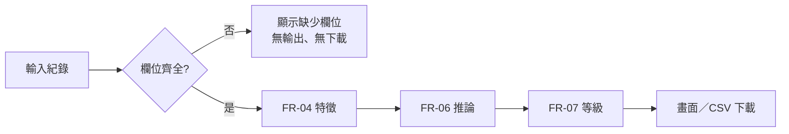

# 03 SRS — 信貸撥貸金額預測工具

> 版本 v1.0｜日期 2026-11-10｜狀態：草稿（D-01 未決）｜審查者：待指派｜上游：`docs/02-prd.md`
> 編號不重用；變更須同步 `src/features.py` 與 `templates/*.html` 的 `toFeat`，並重跑 TC-03、TC-05、TC-06。

## 功能需求

| ID | 可觀察的系統行為 | 來源 AC |
|---|---|---|
| FR-01 | 訓練資料缺少 26 個特徵欄或「撥貸金額」任一欄 → 拋出 `SchemaError`，列出缺少的欄名，不產生任何成品 | AC-03.2、AC-04.1 |
| FR-02 | 清理：移除完全重複的列；移除「撥貸金額」缺值、非數字或 ≤ 0 的列；回報各類移除筆數 | AC-04.1 |
| FR-03 | DBR 截斷界線 = 訓練資料 DBR 的 1%、99% 分位數（取 2 位小數）；評估時只用訓練分割計算 | AC-01.3 |
| FR-04 | 由一筆紀錄產生 31 欄特徵（規則見下方資料字典），Python 與 JS 的結果必須相同 | AC-01.1、AC-03.1 |
| FR-05 | 單筆預測顯示金額（四捨五入到 0.1）、等級、中位數比較；DBR 超界或無擔保總餘額為負時顯示提示 | AC-01.1、AC-01.3 |
| FR-06 | 瀏覽器端梯度提升推論結果與 sklearn 模型相同（誤差 < 0.001） | AC-01.1 |
| FR-07 | 等級：a ≤ cut0 為低；cut0 < a ≤ cut1 為中；a > cut1 為高。cut 取全體訓練資料預測值的 1/3、2/3 分位數。「預測高低」= a > 全體中位數 ? 高 : 低 | AC-01.2 |
| FR-08 | 決策樹：特徵值 ≤ 門檻走左；在葉節點顯示 n、中位數、平均、P25、P75、高於全體中位數的比例，以及完整路徑 | AC-02.1、AC-02.2 |
| FR-09 | `train.py` 依序執行保留集評估、消融、全資料重訓，再匯出模型。任一門檻未通過時結束碼為 2，且不覆寫 `dist/` | AC-04.1、AC-04.2 |
| FR-10 | 批次 CSV：先以 UTF-8（嚴格模式）解碼，失敗改用 Big5；支援引號與逗號；缺任一數值欄或無資料列時拒絕。輸出 = 原欄位 + 3 欄，加 BOM，檔名帶當日日期 | AC-03.1–03.3 |

## 規則與資料字典

主流程：紀錄 → FR-04 特徵 → FR-06／FR-08 推論 → FR-07 等級 → 畫面或 CSV。資料欄位全部由使用者提供；DBR 界線、切點、中位數等「伺服器決定欄位」由訓練時固定，並寫入 HTML。

- **類別四組**（FR-04）：行業 A–E、學歷（高中／專科／大學／碩士／博士）、居住（5 類）、婚姻（5 類）。一個欄位的值經數值轉換後**等於 1** 才算命中；空白、0、2、「abc」都算未命中。同組 5 欄都未命中時，該組「_未知」= 1。
- **數值六欄**（FR-04）：循環比、信用卡循環金額、無擔保總餘額、預借現金次數、信用貸款含現金卡家數、DBR。非數字或空白轉為 0。
- **無擔保總餘額**：小於 0 時改為 0（資料最小值為 −100）。
- **DBR_為0**：原始 DBR == 0 時為 1，要在截斷**之前**判斷（資料中有 1,694 筆）。
- **DBR**：截斷到 [1.13, 21.98]（2026-11-10 訓練值）。負值與 0 都會被截成 1.13，但 0 另有旗標。

決策表（TC-03 的手算例子，界線 = [1.13, 21.98]）：

| 輸入重點 | 預期非零特徵 |
|---|---|
| 行業C=1、大學=1、循環比「abc」、無擔保 −100、DBR 0 | 行業C、大學、居住_未知、婚姻_未知、DBR_為0 = 1；DBR = 1.13 |
| 行業A「1.0」、高中=2、住租賃、未婚、DBR 25、卡循環 3.5 | 行業A、學歷_未知、住租賃、婚姻未婚 = 1；DBR = 21.98；卡循環 3.5 |
| DBR −5 | DBR = 1.13，DBR_為0 = 0 |

**等級邊界**：切點 (30, 50) 時，30 為低、30.01 為中、50 為中、50.01 為高。

## 品質需求

- **NFR-01｜準確度**：保留集（20%，seed 42）上，梯度提升的 MAE ≤ 基準（訓練集中位數）MAE × 0.85；決策樹（葉中位數）的 MAE ≤ 基準 × 0.95。門檻在看到結果之前就已訂定。驗證：TC-07。
- **NFR-02｜一致性**：JS 推論與 sklearn 模型逐筆誤差 < 0.001；JS 與 Python 產生的特徵完全相同。驗證：TC-03、TC-05、TC-06。
- **NFR-03｜外洩透明**：報告必須列出移除「無擔保總餘額、DBR、DBR_為0」後的保留集成績。驗證：TC-07。
- **NFR-04｜可重現**：相同資料與 seed 訓練兩次，模型 JSON 完全相同。驗證：TC-08。
- **NFR-05｜隱私**：成品 HTML 不含任何網路呼叫或外部資源，客戶資料不離開瀏覽器。驗證：TC-13。
- **NFR-06｜效能**：批次 10,000 筆在 Node 中 < 3 秒（實測 226 ms，課堂 Windows 10 電腦）；單筆 < 1 秒。驗證：TC-14。

## 流程與未決事項

待決 D-01（影響 G-04、NFR-01 的意義）：兩個關鍵欄位的取得時點。決策人：資料提供單位；期限：上線前。在 D-01 決定之前，本文件維持草稿。
