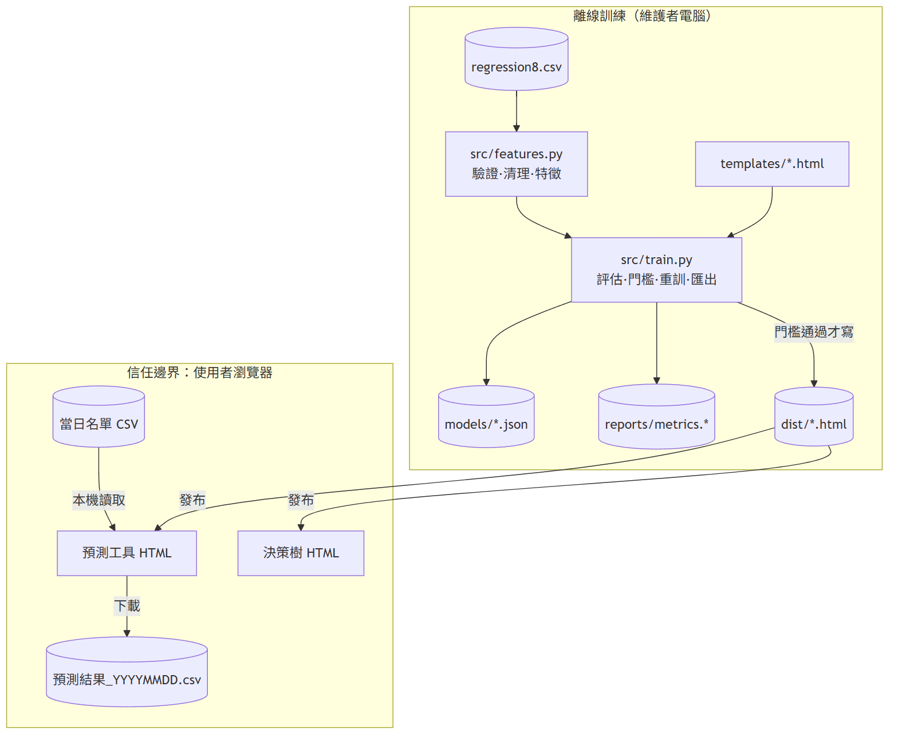
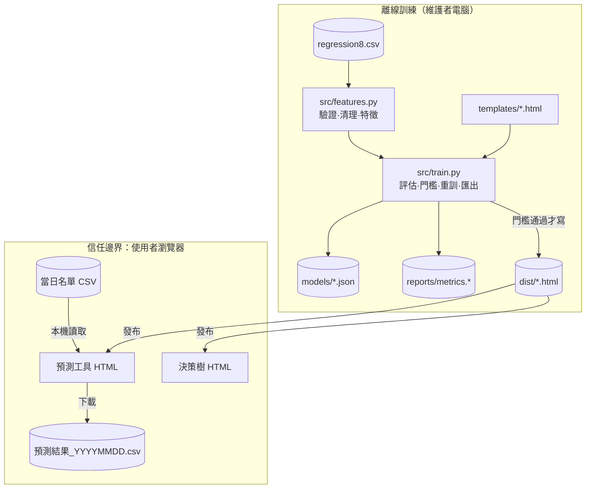

# 04 SAD — 信貸撥貸金額預測工具

> 版本 v1.0｜日期 2026-11-10｜狀態：草稿｜審查者：待指派｜上游：`docs/02-prd.md`、`docs/03-srs.md`
> 技術棧：Python 3.12、pandas 3.0、scikit-learn 1.9、Node 26（只用於測試）、純 HTML/JS（無框架、無 CDN）。

## 情境與品質驅動

最重要的路徑是：電銷人員在 KYC 後打開 HTML 拿到金額，以及每天上傳名單、下載結果交給主管。客戶資料屬於個資與信用資料，所以最高的品質驅動是 **NFR-05 資料不離開瀏覽器**。其次是 **NFR-02 瀏覽器推論與訓練模型一致**，以及 **NFR-03 不讓外洩欄位造成假象**。如果工具故障，電銷人員只是少了一個參考數字，不會影響核貸，所以可用性要求低。部署方式是把兩個 HTML 檔放在共用資料夾或內網，用雙擊開啟。

## 元件與資料流

Mermaid 原始碼（修改後請重新產生 img/architecture.png）

資料流：訓練資料只出現在維護者的電腦上。`features.py` 負責欄位驗證（FR-01）與清理（FR-02）。`train.py` 計算界線、訓練、評估，並把模型參數以 JSON 的形式嵌入 HTML 範本。使用者端的輸入在瀏覽器中由 `toFeat` 正規化（FR-04）。錯誤直接顯示在畫面上，不會有任何資料送出去。

| 元件 | 責任／擁有資料 | 失敗時怎麼處理 |
|---|---|---|
| `features.py` | 欄位規格、清理、特徵（FR-01–04） | 缺欄位時拋 `SchemaError`，訓練中止 |
| `train.py` | 評估、門檻、匯出、報告（FR-09、NFR-01/03/04） | 門檻未過時結束碼為 2，`dist/` 不變 |
| `templates/*.html` | 畫面與 JS 推論（FR-05–08、FR-10） | 少了置換點時，`build_html` 斷言失敗 |
| `dist/*.html` | 交付成品：已嵌入模型，可離線使用 | 輸入錯誤時顯示紅字，不產生輸出 |
| `tests/` | 用 Python oracle 對照 JS 成品（TC-01–14） | 任一測試失敗就不交付 |

## 重要決策與取捨

### ADR-01 單檔靜態 HTML，模型嵌入其中

決定：把模型匯出成 JSON，嵌入 HTML，由瀏覽器自行計算。這樣不需要伺服器，也自然符合 NFR-05。

考慮過：FastAPI 後端加 SQLite。這個方案方便集中記錄與更新模型，但需要主機、帳號、傳輸加密，而且個資會離開使用者電腦，對電銷單位來說負擔過重。

影響與驗證：模型更新需要重新發布 HTML；預測工具約 680 KB，可以接受。必須另外證明 JS 推論與 sklearn 一致，由 TC-05、TC-06 驗證。

### ADR-02 梯度提升樹，目標取 log1p

決定：使用 `HistGradientBoostingRegressor`，參數為 400 棵樹、lr 0.1、31 葉，並關閉 early stopping 以確保可重現。撥貸金額呈右偏分布（中位數 40、最大 300），所以目標取 log1p，預測後再用 expm1 還原。

考慮過：線性迴歸（無法處理 DBR 等非線性關係）、深層隨機森林（模型檔太大，不適合嵌入 HTML）。

影響與驗證：保留集 MAE 18.58，基準為 30.14，NFR-01 通過。

### ADR-03 另提供深度 4 決策樹作為解釋工具

決定：準確度以梯度提升為準，說明理由則用決策樹路徑與葉節點區間（G-03）。決策樹的葉節點至少 200 筆，避免小群組的統計不穩定。

影響：兩個工具的金額可能不同。PRD 規定以預測工具為主要參考，畫面附註也寫明「決策樹較簡單，精準度不及梯度提升樹」。

### ADR-04 先在保留集評估，再用全部資料重訓匯出

決定：門檻與報告以 80/20 保留集為準；匯出的模型則用 100% 的乾淨資料重訓。DBR 界線在評估時只用訓練分割計算。代價是匯出模型本身沒有獨立的保留集成績；這點以相同超參數下的保留集成績作為代理指標。

## 運作、風險與未決

- **重訓與回退**：每次重訓前先備份 `dist/`。新模型門檻未過時，`dist/` 不會被覆蓋（TC-08）。回退方式是把備份的 HTML 拷回原處。
- **可觀察性**：`reports/train.log`、`reports/metrics.md`、`reports/pytest.xml`。畫面副標題會顯示訓練時間與筆數，方便確認使用的是哪一版。
- **部署**：不適用。本次只在本機執行。正式上線前需要補：內網發布位置、版本命名、使用說明。
- **風險 R-01（高）**：D-01 外洩。如果「無擔保總餘額、DBR」是撥貸後的值，實際 MAE 約 24.4 而非 18.6。目前的對策是在報告中列出消融結果，並把 D-01 列為上線前必須決定的事項。
- **風險 R-02（中）**：資料漂移。建議每季用新的撥貸資料重訓，並比對 `metrics.md` 的成績變化。負責人待指派。
